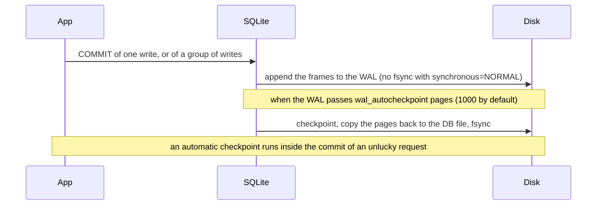

# UML sequences

One sequence diagram per use case ([use-cases.md](use-cases.md)), in Mermaid. Each arrow carries the step it belongs
to (`S1` to `S9`, see [steps.md](steps.md)): that's what we measure, one step at a time.

The participants are the same everywhere:

- **VU:** a k6 virtual user, on another machine.
- **Kernel:** the Linux TCP stack and the socket buffers. Costs CPU, but we only control how we call it.
- **Loop:** the runtime's event loop (Swoole, Workerman, ...). Accepts, reads, writes.
- **App:** our PHP code: routing, auth, validation, JSON.
- **SQLite:** the library, in the same process, through prepared statements.

Draft: the runtime is still open (Q1), so **Loop** stays generic.

## UC0: a connection's life

```mermaid
sequenceDiagram
    participant VU
    participant Kernel
    participant Loop
    VU->>Kernel: SYN (first request of the VU)
    Kernel->>Loop: S1 accept() gives a new fd
    Note over Loop: one fd per VU, 65535 max per process
    loop every 3 to 15 s
        VU->>Kernel: request bytes
        Kernel->>Loop: S1 epoll says readable
        Loop->>Loop: S2 to S8, see UC1 to UC4
        Loop->>Kernel: response bytes
        Kernel->>VU: response
        Note over VU,Loop: idle, the fd stays open (keep-alive)
    end
    alt the server closes idle sockets
        Loop->>Kernel: S1 close() after the idle timeout
        Note over VU,Kernel: risk, the VU may send on a socket being closed
    else the VU stops
        VU->>Kernel: FIN
        Kernel->>Loop: S1 read returns 0, close()
    end
```

## UC1: read the feed

```mermaid
sequenceDiagram
    participant VU
    participant Kernel
    participant Loop
    participant App
    participant SQLite
    VU->>Kernel: GET /feed
    Kernel->>Loop: S1 readable
    Loop->>Loop: S2 read and parse the request
    Loop->>App: S3 route GET /feed
    App->>SQLite: S6 step the feed statement
    Note over SQLite: walk posts_created_at_id_idx, 20 rows<br/>join users by id<br/>count likes per post via likes_post_id_idx
    SQLite-->>App: 20 rows (id, body, created_at, username, like_count)
    App->>App: S7 build the JSON, exact key order
    App-->>Loop: 200, about 5 KB of JSON
    Loop->>Kernel: S8 write headers and body
    Kernel-->>VU: 200 posts
```

## UC2: read a post

```mermaid
sequenceDiagram
    participant VU
    participant Kernel
    participant Loop
    participant App
    participant SQLite
    VU->>Kernel: GET /posts/42
    Kernel->>Loop: S1 readable
    Loop->>Loop: S2 read and parse
    Loop->>App: S3 route GET /posts/:id
    App->>App: S5 validate the id (positive integer)
    alt invalid id
        App-->>Loop: 400 invalid post id
    else valid id
        App->>SQLite: S6 step the post statement (id = 42)
        alt no row
            SQLite-->>App: nothing
            App-->>Loop: 404 post not found
        else found
            SQLite-->>App: 1 row
            App->>App: S7 build the JSON
            App-->>Loop: 200 post
        end
    end
    Loop->>Kernel: S8 write the response
    Kernel-->>VU: response
```

## UC3: like a post

```mermaid
sequenceDiagram
    participant VU
    participant Kernel
    participant Loop
    participant App
    participant SQLite
    VU->>Kernel: POST /posts/42/like + Bearer token
    Kernel->>Loop: S1 readable
    Loop->>Loop: S2 read and parse, keep the Authorization header
    Loop->>App: S3 route POST /posts/:id/like
    App->>App: S4 verify the JWT (HMAC-SHA256, alg, exp, sub, username)
    alt bad or missing token
        App-->>Loop: 401
    else valid token
        App->>App: S5 validate the id
        App->>SQLite: S6 INSERT the like, ON CONFLICT DO NOTHING
        alt the post does not exist
            SQLite-->>App: foreign key or lookup says no post
            App-->>Loop: 404 post not found
        else inserted or already there
            SQLite-->>App: changes() is 1 or 0
            App->>SQLite: S9 commit (alone, or grouped with other writes)
            SQLite-->>App: committed in the WAL
            App->>App: S7 build the JSON
            App-->>Loop: 201 or 200
        end
    end
    Loop->>Kernel: S8 write the response
    Kernel-->>VU: response
```

Open point for the step lab: the schema doesn't say whether foreign keys are enforced (`PRAGMA foreign_keys` is off
by default in SQLite). If they aren't, the 404 needs its own lookup of the post, before or after the insert.

## UC4: write a post

```mermaid
sequenceDiagram
    participant VU
    participant Kernel
    participant Loop
    participant App
    participant SQLite
    VU->>Kernel: POST /posts + Bearer token + JSON body
    Kernel->>Loop: S1 readable
    Loop->>Loop: S2 read and parse, wait for the whole body (Content-Length)
    Loop->>App: S3 route POST /posts
    App->>App: S4 verify the JWT
    alt bad token
        App-->>Loop: 401
    else valid token
        App->>App: S5 decode the JSON, trim, count characters (1 to 500)
        alt bad body
            App-->>Loop: 400 (malformed, required, or too long)
        else valid body
            App->>SQLite: S6 INSERT the post RETURNING id, created_at
            App->>SQLite: S9 commit
            SQLite-->>App: id, created_at
            App->>App: S7 build the JSON (author from the token, like_count 0)
            App-->>Loop: 201 post
        end
    end
    Loop->>Kernel: S8 write the response
    Kernel-->>VU: response
```

## UC5: health check

```mermaid
sequenceDiagram
    participant Client
    participant Loop
    participant App
    participant SQLite
    Client->>Loop: GET /health
    Loop->>App: S2, S3
    App->>SQLite: SELECT 1
    alt ok
        SQLite-->>App: 1
        App-->>Loop: 200 status ok, uptime_s
    else SQLite fails
        App-->>Loop: 503 degraded, unreachable, the error
    end
    Loop-->>Client: S8
```

## Background: durability (S9)

Not a use case of the VU, but it runs on the same CPU and can stall a request.


